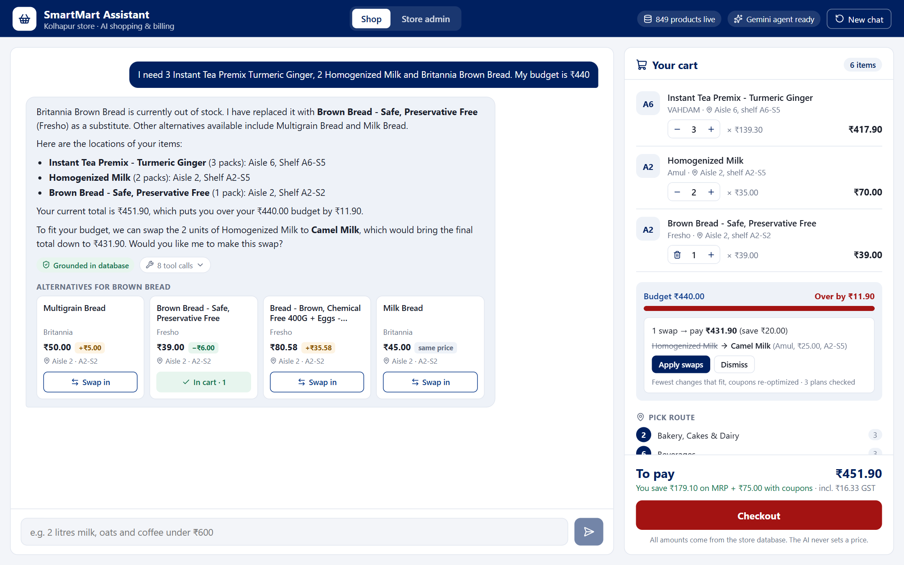

# SmartCart Agent: Conversational Smart-Cart & Billing Assistant

A shopper types or speaks a shopping list, for example *"I need 3 Instant Tea Premix Turmeric
Ginger, 2 Homogenized Milk and Britannia Brown Bread. My budget is ₹440"*. An AI agent then does
the rest:

- finds the **aisle and shelf** of each item
- checks **live stock and price**
- replaces out-of-stock items with **ranked same-type substitutes**
- applies the **best valid combination of coupons**
- fits the cart into the **budget**
- keeps a **running GST-inclusive bill**

**The one rule:** the language model plans, understands and explains. It **never** produces a
price, stock count, aisle, discount, tax or total. Every such number is read from PostgreSQL by
tool functions, and a grounding check rejects any number in a reply that no tool returned.

B.Tech Mega Project, Group D8, Department of CSE (AIML), KIT's College of Engineering (Empowered
Autonomous), Kolhapur. Guide: Prof. Vrishali Prabhu.



## Results

All results come from a 15-goal live evaluation on Gemini 3.5 Flash-Lite, scored by code against
the database (`python scripts/07_evaluate.py`):

| Metric | Result |
| --- | --- |
| Task success | 15 / 15 scripted shopping goals (53 / 53 checks) |
| Grounding | 100%: all 147 ₹ amounts and aisle numbers in the replies matched the database |
| Discount captured | 100% of the brute-force optimum on every cart |
| Substitution | 100% of unavailable items replaced by an in-stock product of the same type |
| Coupon optimizer, 300 random carts | ours 100% · greedy 99.97% · best single coupon 55.6% of the possible discount |
| Automated tests | 108 offline (scripted fake LLM, no API key) + 3 live Gemini |

Full report: [docs/evaluation/EVALUATION_REPORT.md](docs/evaluation/EVALUATION_REPORT.md)

## Features

- **Conversational shopping** in English, Hindi and Marathi, typed or by voice (Chrome/Edge)
- **Shelf-level location**: aisle, shelf and level for every item, plus a pick route in walking order
- **Live stock** with automatic, ranked substitutes for unavailable items, shown as clickable cards
- **Exact coupon optimizer**: the best non-conflicting set, as a maximum-weight independent set
  solved by branch and bound
- **Budget fit**: the fewest swaps to cheaper same-type products, with coupons re-optimized per plan
- **GST-inclusive bill**: CGST/SGST by rate slab; checkout as one atomic database transaction
- **Multi-store comparison**: the same cart priced at two other stores
- **Store admin** with staff login, roles (manager / staff) and an audit log. Price changes
  update every open cart, because carts store no prices
- **Persistent chat memory** in PostgreSQL, so conversations survive a server restart
- **Evaluation harness** and a **user-study mode** (assistant vs manual shopping, timed and scored)

## Architecture

```
React web app ──HTTP──► FastAPI (37 endpoints) ──► LangGraph agent ◄──► Google Gemini
                                   │                      │ tool calls
                                   └── direct ──► Python tool functions ──SQL──► PostgreSQL (15 tables)
```

The agent is a LangGraph state graph. Gemini chooses the tools to call, and the graph enforces
three steps whatever the model does:
- every refused item gets substitutes
- every cart change gets a freshly computed bill
- every reply passes the grounding check

## Tech stack

| Layer | Tools |
| --- | --- |
| Data | BigBasket product dataset (Kaggle), pandas |
| Database | PostgreSQL 16 (Docker), `pg_trgm` fuzzy search, SQLAlchemy + psycopg2 |
| Agent | LangGraph, LangChain, Google Gemini 3.5 Flash-Lite (fallback 3.1 Flash-Lite Preview) |
| API | FastAPI + Uvicorn |
| Frontend | React 19, TypeScript, Vite |
| Tests | pytest with a scripted fake LLM, Puppeteer |

## Quick start (Windows, PowerShell)

Prerequisites: Docker Desktop, Python 3.10, Node.js 20+, a Google Gemini API key and a Kaggle API
key (`kaggle.json`, only needed to download the dataset).

```powershell
git clone https://github.com/mhopareprathmesh5-creator/SmartCartAgent.git
cd SmartCartAgent
copy .env.example .env            # then put your GOOGLE_API_KEY in .env

python -m pip install -r requirements.txt
cd frontend; npm install; npm run build; cd ..

python scripts/00_setup_kaggle_creds.py   # copies kaggle.json from Downloads
python scripts/01_fetch_dataset.py        # downloads the BigBasket CSV
docker compose up -d                      # starts PostgreSQL
python scripts/02_clean_catalog.py        # 27,555 rows -> 849 products
python scripts/03_seed_database.py        # builds all tables and data
python scripts/04_verify_seed.py          # 10 integrity checks

python -m uvicorn smartcart.api.main:app  # open http://127.0.0.1:8000/
```

| Page | Address |
| --- | --- |
| Shop (chat, cart, bill) | http://127.0.0.1:8000/ |
| Store admin (demo logins `manager` / `manager123`, `staff` / `staff123`) | http://127.0.0.1:8000/#/admin |
| Evaluation results | http://127.0.0.1:8000/#/eval |
| User study | http://127.0.0.1:8000/#/study |
| API documentation | http://127.0.0.1:8000/docs |

Run the Python tools as modules (`python -m uvicorn`, `python -m pip`, `python -m pytest`). On some
managed Windows machines the `.exe` launchers are blocked.

## Tests and evaluation

```powershell
python -m pytest -q                # 108 tests, about 10 s, no API key needed
python -m pytest -m live -v        # 3 tests against live Gemini
python scripts/07_evaluate.py      # 15-goal evaluation with live Gemini, about 10 min
python scripts/05_demo_tools.py    # a scripted shopping trip through the tools, no AI
```

Checkout and admin edits change the data. Run `python scripts/03_seed_database.py` to restore the
original store.

## Project structure

```
smartcart/            the application (Python package)
  tools/              grounded tools: search, stock, substitutes, cart, bill, coupons, budget, GST, store comparison
  agent/              LangGraph agent: graph, LLM tools, prompts, grounding check, memory
  api/main.py         FastAPI server; also serves the built web app
  admin.py, auth.py   store staff operations, login and roles
  eval/, study.py     evaluation harness and user-study mode
frontend/             React web app (Shop, Store admin, Evaluation, User study)
db/schema.sql         database schema: 15 tables + catalogue view
data/seed/            hand-written coupons, coupon conflicts and GST rules
scripts/              00–04 build the data, 05 tool demo, 06 terminal chat, 07 evaluation, 08 study report, 09 staff accounts
tests/                automated tests
docs/                 slides, project report and paper drafts, evaluation results, screenshots
```

`CLAUDE.md` holds detailed technical notes for every milestone and the full command list.

## Data

| Data | Source |
| --- | --- |
| Product names, brands, categories, MRP, selling price, rating | Real: BigBasket product dataset (Kaggle), cleaned and sampled to 849 products |
| Aisle/shelf map, stock levels, other stores' prices | Generated with a fixed random seed (42), so every run gives identical data |
| 19 coupons, 12 conflict pairs, GST rates | Hand-written (`data/seed/`). GST rates are simplified by category, because the dataset has no HSN codes |

The raw dataset is not included in this repository. Scripts 00–02 download and prepare it.

## Limitations

- Gemini free tier: 15 requests per minute. One shopping message uses about 4.
- Store layout, stock, coupons and comparison-store prices are synthetic.
- The user study is built but has no participant data yet.
- The app is not deployed to the cloud yet. A Docker image (`Dockerfile`) is ready.

## Team

| Name | PRN |
| --- | --- |
| Mayur Khamamkar | 2324000146 |
| Prathmesh Mhopare | 2324001087 |
| Aniket Mane | 2324000104 |
| Harshvardhan Magdum | 2324000418 |

Guide: Prof. Vrishali Prabhu, Department of CSE (AIML), KIT's College of Engineering (Empowered
Autonomous), Kolhapur.
